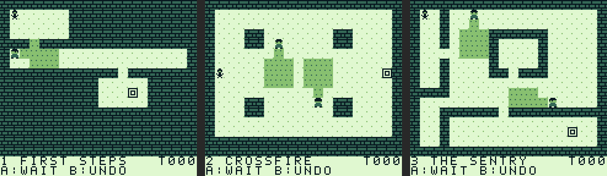
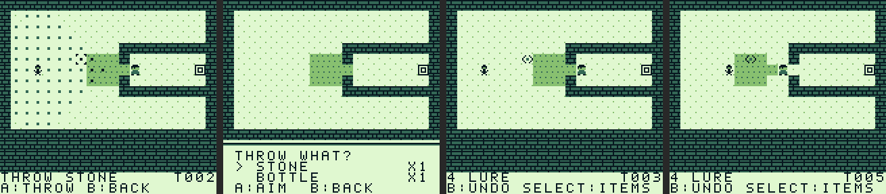
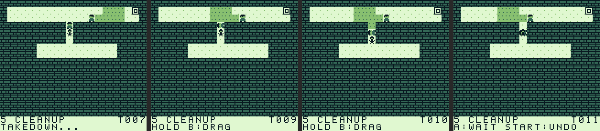
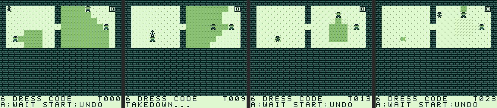

# GB47 — Game Boy stealth puzzle

A top-down, turn-based stealth puzzle game for the original Game Boy.
Enemies move only when you move. The plan is to combine traditional
stealth with social stealth (disguises, dialogue) and combat.



*Rendered from the real tile data and game logic, not an emulator capture.*

## Current state: prototype

- One-screen levels on a 20×16 tile grid, plus a 2-row HUD
- Guards patrol waypoint loops, or stand still as sentries
- Vision cones (4 tiles deep, 3 wide) blocked by walls and drawn on the map
- Getting caught, reaching the exit, 32 turns of undo, restart
- **Distractions:** open the inventory, pick a throwable, and throw it to
  lure guards away
- **Takedowns and bodies:** grab a guard from an adjacent tile, then drag or
  push the body out of sight
- **Disguises:** take a uniform from a body; each guard is hostile,
  an enforcer, or blind to what you're wearing, which sets its vision cone
- 6 levels, each checked solvable by an automated solver

### Controls

| Button | Action |
|---|---|
| D-pad | Move one tile (spends a turn); you can walk over bodies |
| A | Wait one turn / next level after escaping |
| B | Take down an adjacent guard (`B:TAKEDOWN`), or put on the uniform of the body you're standing on (`B:TAKE UNIFORM`) |
| Hold B + D-pad | Drag a body behind you, or push one in front of you |
| SELECT | Open inventory |
| START | Tap: undo. Hold about a second: restart level |

In the inventory, UP/DOWN chooses an item and A starts aiming. While
aiming, dots mark every square you can hit; move the cursor with the
D-pad and press A to throw. B goes back, SELECT cancels.

### Throwing distractions



- You can throw at a floor square up to **6 steps** away (counted along the
  grid) with a clear straight line from you. Throwing spends your turn.
- Every guard within 6 steps of where it lands spends its next move
  turning to look at it.
- The guard with the **shortest walk** to the spot (ties: the lower-numbered
  guard) walks over to investigate. A marker shows where it's heading. It
  then walks back to where it left its route and carries on.
- Every other guard goes back to its routine the following turn; sentries
  face their post again.
- Hearing ignores walls; walking around them doesn't.
- Items are part of the game state, so undo gives them back.

Range and noise are set per item in `item_defs` in `src/game.c`. The stone
and bottle are identical for now.

### Takedowns and bodies



- Standing next to a guard (up, down, left or right) shows `B:TAKEDOWN`.
  If the guard could see you, you'd already be caught, so in practice this
  means from behind or from the side.
- A takedown locks you and the guard in place for **3 turns** (the press
  plus 2 more). Those turns play out automatically so you can watch the
  other guards keep moving. During them the guard can't see, hear or move.
- Afterwards the guard is a **body**. If any guard sees a body, or sees a
  takedown in progress, the alarm goes up and the level is lost.
- Hold B and press a direction next to a body:
  - toward the body: **push** it one tile ahead (blocked by walls, guards
    and other bodies);
  - any other direction: **drag** it into the tile you just left.
- Without B held you walk straight over bodies, so they never block a
  corridor. You can't start a drag while standing on a body.
- Undo rewinds a whole takedown in one step.

Takedown length is `TAKEDOWN_TURNS` in `src/game.h`.

### Disguises



You start in your own clothes. Stand on a body and press B to put on its
uniform (one turn). Your sprite changes to show what you're wearing. Each
body has one uniform, and there's no changing back.

Every guard has an attitude to each disguise, and that sets its cone:

| Attitude | Cone | Shown as |
|---|---|---|
| **Hostile** | Huge: 7 tiles deep, widening to 7 tiles across | Shaded |
| **Enforcer** | Normal: 4 deep, 3 across | Shaded |
| **Blind** | Ignores you. Still uses the normal cone to spot bodies, takedowns, and you doing something **suspicious** | Dotted |

Suspicious means: a takedown, dragging or pushing a body, throwing, or
changing clothes. A blind guard who walks into you just waits for you to
move.

Uniforms and attitudes are set per guard in `src/levels.c`. Guards in
levels 1-5 have no uniform and are enforcers to everything. Disguise
types are `DISGUISE_*` in `src/game.h` (own clothes, GUARD, OFFICER).
Cone sizes are `VISION_RANGE`, `HOSTILE_RANGE` and `HOSTILE_HALF`.

### Turn order

1. Player moves, waits, throws, drags/pushes a body, or starts a takedown.
2. If standing on the exit, the player escapes.
3. If any guard sees the player, they're caught; if a guard sees a body or
   a takedown in progress, the alarm goes up.
4. If something was thrown, guards in earshot turn to look (instead of acting).
5. Every other standing guard acts: patrols, walks to a noise, or walks back.
6. Step 3's checks again; a guard walking into the player also catches them.
7. A takedown in progress counts down; when it ends, the guard is a body.

"Sees" depends on each guard's attitude to your disguise (see above).

## Building

### Game Boy ROM

1. Install [GBDK-2020](https://github.com/gbdk-2020/gbdk-2020/releases)
   (4.3.0 or newer). Unpack it to `~/gbdk`, or set `GBDK_HOME`.
2. Build:

   ```bash
   make
   ```

3. Open `build/stealth.gb` in an emulator. [Emulicious](https://emulicious.net/)
   is recommended because it has a debugger; use `make DEBUG=1` for source-level
   debugging. Also test on SameBoy or BGB.

Every push also builds the ROM on GitHub Actions. Download it from the
`stealth-rom` artifact on the run.

### Rule tests (no GBDK needed)

```bash
make test
```

This compiles the game rules with `gcc`, runs unit tests, and runs a
breadth-first solver on every level. The solver tries every action: moves, waits,
throws, takedowns and drags. It prints each level's shortest solution
(`U R D L W` moves/wait, lowercase `u r d l` drag/push that way,
`TAKEDOWN`, `UNIFORM`, and `S7,5` means "stone at (7,5)", `B` is a bottle) and fails
if any level is unsolvable. A table in `tests/test_game.c` lists what each
level teaches (level 4 needs items; level 5 needs a takedown and moving
the body; level 6 needs a disguise). The solver re-runs with that mechanic switched off and fails if
the level can still be beaten. **Run it after every level edit.** It takes a few seconds because
throws multiply the number of possibilities.

## Code layout

| Path | What it is |
|---|---|
| `src/game.c`, `game.h` | All game rules: turns, patrols, vision, undo. No hardware access, so it also compiles on a PC. |
| `src/levels.c` | Level data as ASCII maps, guard waypoints, uniforms and attitudes, and starting items. |
| `src/main.c` | Game Boy side: input, drawing the map/sprites/HUD. Only reads `GameState`. |
| `tools/gen_tiles.py` | Turns ASCII pixel art into `src/tiles.c`/`tiles.h`. Run `make tiles` after editing the art. |
| `tests/test_game.c` | Unit tests and the level solver. |

Keep rules in `game.c` and presentation in `main.c`. That split is what
makes undo, the solver, and PC testing possible.

## Roadmap

1. ~~Grid movement, patrolling guard, vision, detection, undo~~
2. ~~Distraction throwing~~, ~~takedowns and bodies~~, ~~disguises~~
3. **Write more levels and find out what makes them fun**
4. Load levels exported from [Tiled](https://www.mapeditor.org/) instead of ASCII
5. Dialogue: talking costs a turn and changes a guard's state (sends them away, distracts them)
6. Title screen, save data (battery SRAM), music (hUGETracker)

Introduce each new mechanic with its own teaching level, and let the
solver keep every level honest.
