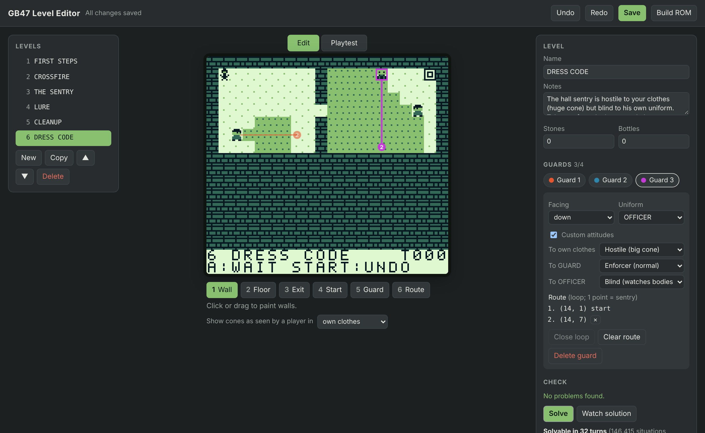
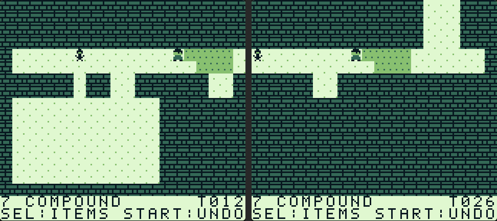

# GB47 — Game Boy stealth puzzle

A top-down, turn-based stealth puzzle game for the original Game Boy.
Enemies move only when you move. The plan is to combine traditional
stealth with social stealth (disguises, dialogue) and combat.


*Rendered from the real tile data and game logic, not an emulator capture.*

## Current state: prototype

- Levels of 1-3 screens across and down; the view cuts from screen to screen
- Guards patrol waypoint loops, or stand still as sentries
- Vision cones (4 tiles deep, 3 wide) blocked by walls and drawn on the map
- Getting caught, reaching the exit, 32 turns of undo, restart
- **Distractions:** open the inventory, pick a throwable, and throw it to
  lure guards away
- **Takedowns and bodies:** grab a guard from an adjacent tile, then drag or
  push the body out of sight
- **Disguises and zones:** take a uniform from a body. A level is divided
  into zones (a dance floor, a backstage...), each legal, trespassing or
  hostile for each outfit, and guards enforce the rule of the zone you
  are standing in
- **Building blocks:** doors, windows, railings, security doors, curtains,
  mesh screens and vents, each blocking a different mix of movement,
  sight and throws
- **Linked maps:** a level can be up to 4 maps joined at their edges
- **Tileset painting:** paint a level's look from a tileset image
  (`tilesets/`), separately from what each cell does
- **Characters and scripts:** guards, dogs and anyone else are one kind
  of character, each with its own look (sprites you can paint in the
  editor). Any of them can patrol, see you (or not), be taken down, and
  be talked to: walk up, press B, and a message box shows what they say;
  a small script can change the level, like making the stairs appear. On
  level 3 you have to pet the dog
- **Level transitions:** finishing a level dips to black and back in the
  style chosen for that level: fade, wipe, curtain, iris (a circle closing
  on you), dissolve, diagonal wipe, blinds, interlace, or a plain cut
- 9 levels, each checked solvable by an automated solver
- **Level editor** with in-editor playtesting and a built-in solver

## Level editor



```bash
make editor
```

This needs only `gcc` and Python 3 (no extra packages). It builds the game
rules into `build/libgame.so`, starts a local server, and opens
`http://127.0.0.1:8047` in your browser. Stop it with Ctrl+C.

- **Art:** pick a tile from the **tileset** under the palette and paint
  with it. It also sets the cell's behaviour if the tile has one (shown
  as a letter on the tile); tick **Look only** to change just the look.
  **Erase art** (`0`) returns cells to the built-in look. The **When
  painted, set behaviour to** menu changes a tile's behaviour. **Auto-paint
  map** repaints the whole map from its walls, and **Auto-tile** does the
  same around each stroke as you paint (see *Painting with a tileset*). **Show behaviour** labels painted cells whose
  behaviour isn't what that tile normally means.
- **Maps:** each level has tabs Map 1, Map 2, …; **+ Map** adds one (up
  to 4). The **Links** panel joins the current map's edges to other
  maps, with an offset; linked edges are marked on the map with where they
  lead. Tools and guards work on the map you're viewing.
- **Size:** pick how many screens across and down (sizes that won't fit
  in RAM are greyed out). Dashed lines are the screen boundaries; **Zoom**
  fits big maps on screen.
- **Paint** any tile from the palette: `1` wall, `2` floor, `3` exit, or a
  building block by its map letter (`D` door, `W` window, `R` railing,
  `S` security door, `C` curtain, `M` mesh, `V` vent). The hint line says
  what the selected tile blocks. Place the player start with `4`.
- **Character** (`5`): click to add one (max 4 per map), click to select,
  drag to move. Guards, dogs, cleaners and so on are all characters; the
  **Characters** panel sets what each one is:
  - **Look**: which sprites draw it (guard, officer, dog, ...). **Edit
    look…** paints its six frames pixel by pixel (facing up, right, down,
    left, being taken down, lying as a body); **New look…** starts a new
    one from a copy. Looks are saved to `tilesets/characters.png` straight
    away, like tileset tiles, and every level can use them.
  - **Facing**, and the **uniform** you get from its body.
  - **Watches**: yes (it has a cone and enforces who may be where), or no
    (no cone at all: it doesn't catch you or notice bodies, like the dog).
  - **Sees through**: tick an outfit to make it an enforcer for it. It
    then treats someone wearing that outfit as trespassing even where the
    outfit is legal (the officer who knows every guard's face).
  - **Can be taken down**.
  - **Can be talked to (B)**: its prompt word (`PET` shows as `B:PET`)
    and its script. Someone you can talk to can't be taken down: B talks.
- **Route** (`6`): click to add waypoints to the selected character, who
  walks the loop (one point = stands still). Corners are inserted for
  you, so legs stay straight. Drag a point to move it; right-click removes
  it. **Close loop** adds the corner needed to walk back to the start.
- **Scripts** are a list of steps, run top to bottom when the player
  talks: **Say** (with a live preview of the Game Boy's message box: 3
  lines of 18 characters, upper case), **Set flag**, **Clear flag**, and
  **If flag** with steps for "then" and "otherwise". Flags are names you
  make up; a level can use 8, shared by all its maps.
- **Switch cell** (`7`): a cell that turns into something else when a
  flag is set, e.g. floor that becomes the exit. It is drawn with a dashed
  outline and a faint picture of what it becomes. Per switch cell: the
  flag, what it turns into, and the tileset tile it then shows.
- **Pickup** (`9`): click a cell to put an item there (up to 8 per map);
  set which item and how many in the Pickups panel. Walking onto it puts
  it in the player's inventory. Click one to select it, drag to move it.
- **Portal** (`O`): click one end, then the other: on the same map, or
  click another map's tab in between, for stairs between floors. Stepping
  onto either end puts the player on the other. Each end is drawn as a
  numbered ring (`1→M2`: portal 1, leading to map 2); the Portals panel
  lists them, and ✕ deletes one. Drag an end to move it. A map reached
  only by a portal needs no linked edge.
- **Select** (`Q`): drag a box over cells. Drag inside it to move what's
  there (terrain, art, zones, and the characters' route points, pickups,
  switch cells and portal ends on those cells); the cells left behind
  become wall. Arrow keys nudge the selection a cell, Shift+arrows a whole
  screen. Delete clears it to wall; Ctrl+C / Ctrl+V copy and paste the
  terrain, art and zones (pasted at the selection); Ctrl+A selects the
  whole map; Esc lets go. Anything pushed off the map is dropped, and the
  hint line says so; Ctrl+Z undoes any of it. (To make a map smaller,
  move its contents with Select, then pick fewer **Screens**: resizing
  keeps the top-left.)
- **Zones** (the panel on the right, shared by every map of the level):
  name each area of the level and set, per outfit, whether wearing it
  there is **L**egal, **T**respassing or **H**ostile. **+ Zone** adds one
  (up to 16); ✕ deletes one, and its cells go back to the first zone,
  which holds every cell you haven't painted. Click a zone, then paint it
  on the map with the Zones tool (`8`): click or drag, Shift+click fills a
  room (it stops at doors and doorways), **Fill map** does the whole map.
  **Show** tints the map by zone, with each zone's name on it (the
  default while painting), or green/amber/red by the rules for the outfit
  the cone preview is set to: the view that answers "is this fair in a
  GUARD uniform?". A new level has one zone, "everywhere", where your
  suit trespasses and uniforms are legal.
- Per level: name, design notes, and starting stones/bottles.
- **Transition**: how the screen dips to black when the level is finished.
  Choosing one plays it on the picture (so does **Preview**), and finishing
  a level in Playtest plays it too. The patterns come from the same code
  the ROM uses (`src/trans.c`).
- **Disguises** (shared by every level): what the player can wear. Your
  own suit is always first; the rest are the uniforms characters' bodies
  give (up to 8 in all). Each is drawn with a look (the player turns to
  face the way it last moved, using the look's up, right, down and left
  frames): pick one, or **Edit…** to paint it. **+ Disguise** makes a
  new one with a copy of the suit's look and opens the painter. Renaming
  one renames it everywhere, saved levels included; deleting one is
  refused while any level uses it (the message names them). Changes save
  straight away, like looks. Every outfit list in the editor (zone rules,
  uniforms, "sees through", the cones preview) follows this list.
- **Cones preview:** shows every guard's starting cone as seen by a player
  in your own suit or any of the disguises.
- **Problems** are listed live, in plain language: missing start, a route
  through a wall, a name too long for the HUD, and so on.
- **Solve** finds the shortest solution and reports which mechanics the
  level actually needs (e.g. "Needs a disguise", "Optional: items").
  **Watch solution** replays it.
- **Playtest** (or press `P`) plays the level with the real rules from
  `src/game.c` and the same screen, screen cuts and HUD as the ROM.
  Keyboard: arrows = D-pad, `Z` = A, `X` = B, `Shift` = SELECT (hold +
  arrows to look at other screens), `Enter` = START, `Esc` = back to
  editing.
- **Undo/redo** (Ctrl+Z / Ctrl+Shift+Z) for every edit. Level list: add,
  copy, reorder, delete.
- **Save** (Ctrl+S) writes `levels/levels.json` and regenerates
  `src/levels.c`; it refuses while any level has problems. **Build ROM**
  runs `make` and shows the output.

Levels live in `levels/levels.json` (format documented at the top of
`tools/gen_levels.py`). You can also edit it by hand; `make` regenerates
`src/levels.c` when the JSON changes.

### Controls

| Button | Action |
|---|---|
| D-pad | Move one tile (spends a turn); you can walk over bodies |
| A | Wait one turn / next level after escaping (through the level's transition) |
| B | Take down an adjacent guard (`B:TAKEDOWN`), talk to a character next to you (`B:PET`, `B:TALK`, ...), or put on the uniform of the body you're standing on (`B:TAKE UNIFORM`). In a message box, A or B continues |
| Hold B + D-pad | Drag a body behind you, or push one in front of you |
| SELECT (tap) | Open inventory |
| Hold SELECT + D-pad | Look at the neighbouring screens; let go to return |
| START | Tap: undo. Hold about a second: restart level |

In the inventory, UP/DOWN chooses an item and A starts aiming. While
aiming, dots mark every square you can hit; move the cursor with the
D-pad and press A to throw. B goes back, SELECT cancels.

### Levels made of several maps

A level can be up to **4 maps**, each up to 2×3 screens (the RAM limit),
joined at their edges. Walk off an edge that's linked to another map
and you step into it at the matching spot.

- Only the map you're in is live. Guards in other maps stand still, and
  bodies stay where you left them, until you come back.
- Crossing takes a turn. Guards in the new map get one look at where you
  arrive, but don't move that turn.
- Your items, disguise and turn count come with you. You can't drag a
  body or be mid-takedown across an edge.
- Undo steps back across crossings too.
- Maps are separate: guards can't see, hear or walk from one map into
  another. Put crossings at natural breaks (corridors, doorways).
- The player always starts in the level's first map; exits can be in any.

A link joins one map's edge to another map's opposite edge, with an
**offset**: which row (for left/right) or column (for up/down) of this map
the other map's first row/column lines up with. Openings on both sides
must line up, and the editor's problem list says exactly where they
don't. In `levels.json` a level has `maps` (each with `map` and `guards`)
and `links` (`from`, `edge`, `to`, `offset`). In `src/levels.c` each map
is one `LevelDef`; a level's maps are consecutive, and `part` and `link`
tie them together. `src/world.c` does the crossing and undo.

### Painting with a tileset

Each map has two layers:

- **Behaviour** (the map letters: wall, floor, door…) decides the rules.
  Unpainted walls draw as flat black.
- **Art** decides the look: which tileset tile is drawn on each cell.
  Cells without art use the built-in graphics for their kind, so levels
  don't need painting at all.

The tileset is `tilesets/dungeon.png` (CC0, 8×8 tiles) with settings in
`tilesets/dungeon.json`. Colours are turned into the Game Boy's 4 shades
by brightness; `thresholds` sets the cut-offs. Each tile can have a
**behaviour** (`"36": "D"` makes tile 36 a door): painting with it sets
the cell's behaviour too, so painting a wall tile makes a wall. Tiles
without one only change the look.

On the Game Boy, each map loads the tiles it uses into video memory when
you enter it (the screen blanks for a moment). Cones and the aiming dots
still have to show on painted cells, so the game makes shaded copies of
each tile as it loads: a tile used only on walls needs 1 of the 195 free
tile slots, one on exits or mesh 3, one on floor 5. The editor shows the
count, and the problem list says if a map uses too many.

**Auto-paint** draws rooms as thin outlines on a black void, from the
map's walls alone. Every level is painted this way; use the editor's
**Auto-paint map** button (or `python3 tools/autopaint.py` for every
level) after changing walls, then touch up by hand. For each wall:

1. floor below: a wall face (tiles 66, 1, 1 repeating along the wall);
2. floor to the right / left: a side wall (16 / 19);
3. floor diagonally below-right / below-left: a top corner (0 / 3);
4. floor above: a bottom edge (1);
5. floor diagonally above-right / above-left: a bottom corner (32 / 35);
6. nothing open around it: left unpainted, which draws flat black.

Floor becomes tile 87, exits stairs (52), doors and one-tile gaps in a
horizontal wall a door (36; a gap keeps behaving as floor), vents a grate
(18). The tile numbers are under `autopaint` in the tileset settings.

Those are only the starting rules. Auto-paint **learns from your levels**:
for every shape of cell (a wall or floor plus which of its 8 neighbours
are open) that you've hand-painted, it uses the tile you used most often
there. And painting a tile by hand **teaches** that shape outright: the
latest tile you painted onto a shape wins over both the rules and the
majority (the editor shows how many shapes it has been taught; **Forget
taught shapes** clears them). Taught shapes are saved under
`autopaint.taught` in the tileset settings.

**Auto-tile** (the checkbox under the palette, on by default) does this
as you edit: painting walls, floor, exits or doors repaints the art of
the cells around your stroke (and the rest of a wall face it touches).
One Undo takes back the stroke and its repaint.

**Painting tiles:** double-click a tile in the editor's tileset (or use
**Edit pixels**) to paint it pixel by pixel in the 4 Game Boy shades:
pencil and fill, flip, rotate, shift, copy/paste between tiles, undo,
with previews of the tile in game, repeated 3×3, and inside a guard's
view. The lightest shade shows the floor through. **Save tile** writes it
into the tileset PNG (as greys that convert back to exactly those shades;
the tile's original colours are replaced) and regenerates `src/levels.c`.
**+ 16 blank tiles** adds a row to the sheet without renumbering anything.

To use your own tileset, put the PNG in `tilesets/` and point `image` in
`tilesets/dungeon.json` at it. Keep the same tile positions, or repaint,
since levels refer to tiles by number.

### Building blocks

Every tile blocks some combination of four things:

| Tile | Map | Player & bodies | Guards | Sight | Throws | Use it for |
|---|---|---|---|---|---|---|
| Wall | `#` | ✕ | ✕ | ✕ | ✕ | |
| Floor | `.` | | | | | |
| Exit | `E` | | | | | reaching any exit wins |
| Door | `D` | | | ✕ | ✕ | breaking line of sight between rooms |
| Window | `W` | ✕ | ✕ | | ✕ | guards watching between rooms |
| Railing | `R` | ✕ | ✕ | | | balconies, pits: see and throw across |
| Security door | `S` | ✕ | | ✕ | ✕ | guard-only routes |
| Curtain | `C` | | | ✕ | | hiding spots you can throw through |
| Mesh | `M` | | | | ✕ | see-through screens that stop throws |
| Vent | `V` | | ✕ | ✕ | ✕ | player-only routes |

- Anything standing on a tile that blocks sight is **hidden**: you in a
  vent, curtain or doorway, or a body you've pushed there.
- Bodies move wherever the player can.
- A throw needs a clear path and must land on a tile that doesn't block
  throws. A stone on a railing still draws a guard, who walks up to the
  railing, looks, and goes back.
- Hearing still ignores walls of every kind.

The table lives in `cell_blocks[]` in `src/game.c` (and `TILES` in
`tools/gen_levels.py`, which a test keeps in step). Adding a tile means a
new `CELL_*`, a map letter, a row in both tables, and a graphic in
`tools/gen_tiles.py`.

### Multi-screen levels



A level is 1 to 3 screens across and 1 to 3 down (each screen is 20×16
tiles), up to 2,048 tiles in total: 1×1, 2×1, 3×1, 1×2, 2×2, 3×2, 1×3 or
2×3 screens. The tile limit is RAM: guard pathfinding needs one byte per
tile.

- The view shows one whole screen and **cuts** to the next when you step
  across an edge. No scrolling motion.
- While aiming, the view shows the screen the cursor is on.
- Hold SELECT and use the D-pad to look at the neighbouring screens; let
  go to return. A quick tap of SELECT still opens the inventory (it opens
  when you let go).
- Guards on other screens keep moving, and their cones reach across screen
  edges. Look before you step across.
- The HUD is drawn in the window layer, so it never moves.

How it works: the Game Boy's background map is 32×32 tiles and wraps, so
`main.c` draws the current screen into it at the level position modulo 32
and sets the scroll registers to match. `game.c` reads the map straight
from ROM.

### Throwing distractions


- You can throw at a floor square up to **6 steps** away (counted along the
  grid) with a clear straight line from you. Throwing spends your turn.
- Every guard within 6 steps of where it lands spends its next move
  turning to look at it.
- The guard with the **shortest walk** to the spot (ties: the lower-numbered
  guard) walks over to investigate. A marker shows where it's heading. It
  then walks back to where it left its route and carries on.
- Every other guard goes back to its routine the following turn; sentries
  face their post again.
- Hearing ignores walls; walking around them doesn't.
- Items are part of the game state, so undo gives them back.

Range and noise are set per item in `item_defs` in `src/game.c`. The stone
and bottle are identical for now.

### Takedowns and bodies


- Standing next to a guard (up, down, left or right) shows `B:TAKEDOWN`.
  If the guard could see you, you'd already be caught, so in practice this
  means from behind or from the side.
- A takedown locks you and the guard in place for **3 turns** (the press
  plus 2 more). Those turns play out automatically so you can watch the
  other guards keep moving. During them the guard can't see, hear or move.
- Afterwards the guard is a **body**. If any guard sees a body, or sees a
  takedown in progress, the alarm goes up and the level is lost.
- Hold B and press a direction next to a body:
  - toward the body: **push** it one tile ahead (blocked by walls, guards
    and other bodies);
  - any other direction: **drag** it into the tile you just left.
- Without B held you walk straight over bodies, so they never block a
  corridor. You can't start a drag while standing on a body.
- Undo rewinds a whole takedown in one step.

Takedown length is `TAKEDOWN_TURNS` in `src/game.h`.

### Disguises


You start in your own clothes. Stand on a body and press B to put on its
uniform (one turn). Your sprite changes to show what you're wearing, and turns to face the way you last moved (or whoever you grab or talk to, or where you throw). Each
body has one uniform, and there's no changing back. Which disguises
exist, and how you look in each, is up to the level designer: they are
listed in `tilesets/characters.json` and made in the editor.

**Zones.** A level is divided into zones, painted in the editor and
shared by all its maps. Each zone has a rule for each outfit, and guards
enforce the rule of the zone you are standing in:

| Where you stand is | A guard | Its cone on that cell is |
|---|---|---|
| **Legal** | Ignores you, unless you commit a **crime** (below) | Dotted |
| **Trespassing** | Catches you in its normal cone: 4 tiles deep, 3 across | Shaded |
| **Hostile** | Catches you in a huge cone: 7 deep, widening to 7 across | Shaded |

So one cone can be dotted on the dance floor and shaded backstage, and it
changes when you change clothes. A guard who walks into you where you're
legal just waits for you to move.

**Crimes** are caught with the huge cone by every guard that watches,
wherever you are: a takedown (including one still in progress), dragging
or pushing a body, throwing, or changing clothes. The dotted part of a
cone shows where a guard would catch a crime but doesn't mind you being
there. Bodies lying around are spotted with the normal cone.

An **enforcer** is the exception: a guard tagged as seeing through an
outfit treats anyone wearing it as trespassing, even where it is legal.

A level without zones treats your own suit as trespassing everywhere and
uniforms as legal everywhere. DRESS CODE has two zones, with its hall
hostile to the suit and the room on the left only trespassing. The rules are `ACCESS_*` in `src/game.h` and the number
of disguises `DISGUISE_TYPES` in the generated `src/levels.h`; cone sizes are `VISION_RANGE`, `HOSTILE_RANGE` and
`HOSTILE_HALF`.

### Pickups and portals

A **pickup** is an item (a stone or a bottle, any number) lying on a
cell: walk onto it and it's yours. Undo puts it back.

A **portal** joins two cells of a level, on the same map or on two maps
(stairs from a ground floor to an upper floor). Stepping onto one end
puts you on the other in the same turn, like walking off a linked edge:
on another map, its characters get a look at you but don't move that
turn. Arriving on a portal doesn't send you back; step off and on again
to go back. You can't drag a body through one.

### Characters, talking, scripts and switch cells

Everyone in a map is a character: guards, the dog, anyone. They all work
the same way. Each walks a route or stands still, blocks walking while
standing, hears noises (the closest one goes to look), and watches with
a cone, enforcing the map's access rules. One that **doesn't watch** has
no cone at all: it never catches you, notices bodies or raises the alarm.
The dog doesn't watch. A character can also be made impossible
to take down.

A character with a script can be talked to. Stand next to it and the HUD
shows its prompt (`B:PET`). Pressing B talks: its script runs, a message
box shows what it says, and the other characters take their turn as
after any other action. Talking isn't suspicious. While someone you can
talk to is next to you, B talks rather than taking anyone down, and a
character you can talk to can't be taken down at all. Characters keep
talking while they patrol: talk to them wherever they are.

Each character has a **look**: six 8×8 sprites (facing up, right, down,
left, being taken down, a body) in `tilesets/characters.png`, one row
per look, named in `tilesets/characters.json`. Paint them in the editor.
The player's look depends on the disguise worn (see Disguises in the
editor). The Game Boy has room for 41 looks, the player's included.

Scripts set and clear the level's flags, and switch cells follow them at
once. Undo takes flags back like everything else. In Playtest, the line
under the keys shows which flags are set.

Text is upper case for now: the font has only `0-9 A-Z : ! - . > ?`.

### Turn order

1. Player moves, waits, throws, talks, drags/pushes a body, or starts a
   takedown.
2. If standing on the exit, the player escapes.
3. If any guard sees the player, they're caught; if a guard sees a body or
   a takedown in progress, the alarm goes up.
4. If something was thrown, guards in earshot turn to look (instead of acting).
5. Every other standing guard acts: patrols, walks to a noise, or walks back.
6. Step 3's checks again; a guard walking into the player also catches them.
7. A takedown in progress counts down; when it ends, the guard is a body.

"Sees" depends on what you wear and where you stand (see Disguises).

## Building

### Game Boy ROM

1. Install [GBDK-2020](https://github.com/gbdk-2020/gbdk-2020/releases)
   (4.3.0 or newer). Unpack it to `~/gbdk`, or set `GBDK_HOME`.
2. Build:

   ```bash
   make
   ```

3. Open `build/stealth.gb` in an emulator. [Emulicious](https://emulicious.net/)
   is recommended because it has a debugger; use `make DEBUG=1` for source-level
   debugging. Also test on SameBoy or BGB.

Every push also builds the ROM on GitHub Actions. Download it from the
`stealth-rom` artifact on the run.

### ROM space

```bash
make usage
```

prints how full the ROM banks and RAM are (GBDK's `romusage`); CI prints
it on every build. The cartridge is MBC5 with 64 KB of ROM in four banks
and 8 KB of RAM (`src/far.h` has the layout):

| Bank | Holds | Free |
|---|---|---|
| 0 | the rules, GBDK | 1.7 KB |
| 1 | `main.c`, built-in tiles, the level table, scripts and text, looks | 4.0 KB |
| 2 | map cells and zone maps | 9.4 KB |
| 3 | painted art | 12.9 KB |

About 5.4 KB of the 8 KB of work RAM is free; the current map and the
pathfinding arrays live in cartridge RAM. Emulators will write a `.sav`
file next to the ROM (nothing is saved in it yet).

### Rule tests (no GBDK needed)

```bash
make test
```

This compiles the game rules with `gcc`, runs unit tests, and runs an
A* solver on every level. The solver tries every action: moves, waits,
throws, takedowns and drags. It prints each level's shortest solution
(`U R D L W` moves/wait, lowercase `u r d l` drag/push that way,
`TAKEDOWN`, `UNIFORM`, and `S7,5` means "stone at (7,5)", `B` is a bottle) and fails
if any level is unsolvable. A table in `tests/test_game.c` lists what each
level teaches (level 4 needs items; level 5 needs a takedown and moving
the body; level 6 needs a disguise; level 7, the 2×2-screen level, needs
the stone; level 8 needs the vent, checked by turning every vent into
wall). Level 9 is two linked maps. The solver re-runs with that mechanic switched off and fails if
the level can still be beaten. **Run it after every level edit.** The solver uses A* search (the
walking distance to the nearest exit, or through a linked edge to one,
guides it), so even big levels solve in seconds while still finding a
shortest solution. Wide-open multi-map levels with every mechanic in
play can still be too big; corridors and rooms keep the search small. Proving a level
*can't* be beaten still means checking every reachable situation; it
gives up after 2 million and reports "too big to tell".

## Code layout

| Path | What it is |
|---|---|
| `src/game.c`, `game.h` | All game rules: turns, patrols, vision, undo. No hardware access, so it also compiles on a PC. |
| `levels/levels.json` | **Level data** (source of truth): maps, zones and zone maps, guard routes, uniforms and enforcer tags, starting items. |
| `src/levels.c`, `levels_maps.c`, `levels_art.c`, `levels.h` | Generated from the JSON by `tools/gen_levels.py`, one file per ROM bank. Don't edit. |
| `src/far.c`, `far.h` | The ROM bank layout, and reading level data out of the data banks. |
| `tools/editor/` | Level editor: `server.py` (local server), `game_lib.py` (Python bridge to the C rules), and the page. |
| `tools/solver.c` | A* solver, shared by the tests and the editor. |
| `tilesets/` | Tileset images and their settings (shade thresholds, tile behaviours). |
| `src/art.c`, `tools/tileset.py` | Painted art: map art layers, shaded copies for cones and aiming, and the tileset loader (with a standard-library PNG reader, `tools/png.py`). |
| `src/trans.c`, `trans.h` | Level transition patterns (which screen tile changes at which step). No hardware access: `main.c` plays them, the editor previews them. |
| `src/main.c` | Game Boy side: input, drawing the map/sprites/HUD. Only reads `GameState`. |
| `tools/gen_tiles.py` | Turns ASCII pixel art into `src/tiles.c`/`tiles.h` (built-in graphics, font). Run `make tiles` after editing the art. Character and player looks are `tilesets/characters.png` instead. |
| `tests/test_game.c` | Unit tests, plus solver checks for every level. |
| `tests/test_editor.py` | Checks the editor's bridge and that `src/levels.c` matches the JSON (`make test-editor`). |

Keep rules in `game.c` and presentation in `main.c`. That split is what
makes undo, the solver, and PC testing possible.

## Roadmap

1. ~~Grid movement, patrolling guard, vision, detection, undo~~
2. ~~Distraction throwing~~, ~~takedowns and bodies~~, ~~disguises~~
3. ~~Level editor~~
4. **Write more levels and find out what makes them fun**
5. ~~NPC dialogue and simple scripts~~ (the dog on level 3; how it was built is in
   [`docs/dialogue-plan.md`](docs/dialogue-plan.md)). Later: more script steps (give an item,
   send a guard somewhere), talking to guards, a lower-case font
6. ~~Zones with a rule per outfit~~, ~~disguises made in the editor, with their own
   looks~~ ([`docs/zones-plan.md`](docs/zones-plan.md))
7. Title screen, save data (battery SRAM), music (hUGETracker)

Introduce each new mechanic with its own teaching level, and let the
solver keep every level honest.
